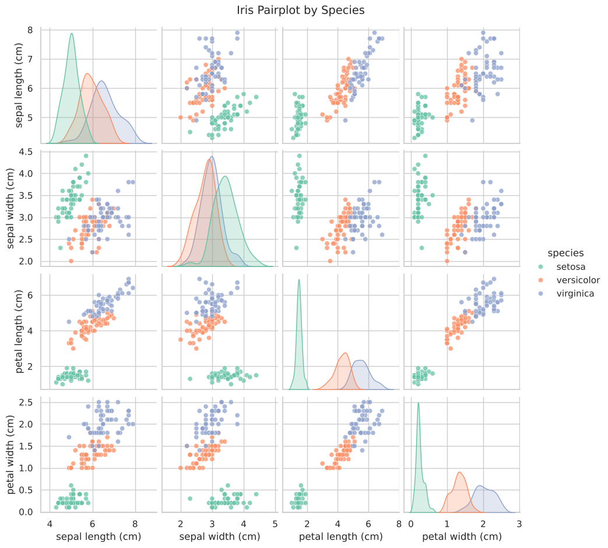
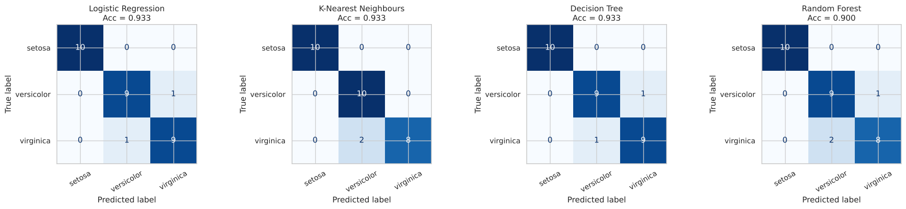
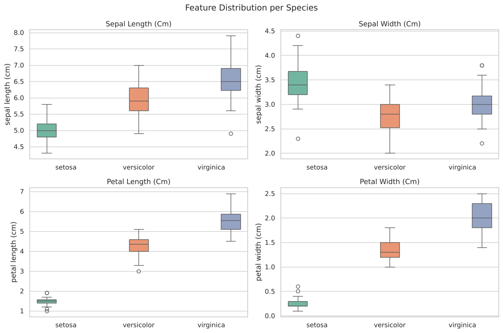
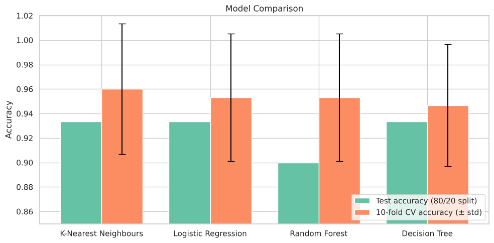

# 🌸 Iris Flower Classification

**Oasis Infobyte Internship (OIBSIP) · Data Science · Task 1**
**Author:** Anshu Raj

## Objective
Train machine learning classification models to identify the species of an iris flower (**Setosa**, **Versicolor** or **Virginica**) from four physical measurements: sepal length, sepal width, petal length and petal width.

## Tech Stack
Python · scikit-learn · pandas · NumPy · matplotlib · seaborn · Jupyter Notebook

## Dataset
The classic Iris dataset, loaded directly with `sklearn.datasets.load_iris()`. No download is needed.
150 samples, 4 numeric features, 3 balanced classes (50 per species), no missing values.

## Project Structure
```
DataScience-Task1-IrisFlowerClassification/
├── Iris_Flower_Classification.ipynb   # complete, executed notebook
├── requirements.txt
├── README.md
└── outputs/                           # saved plots + HTML export of the notebook
```

## Workflow
1. **EDA:** shape, dtypes, null check, descriptive statistics, class balance, per-species means
2. **Visualisations:** pairplot by species, box plots per feature, correlation heatmap
3. **Feature selection discussion:** petal length and petal width are the most discriminative features (Random Forest importance ≈ 0.46 and 0.42)
4. **80/20 stratified train/test split**
5. **Models:** Logistic Regression, K-Nearest Neighbours (both with `StandardScaler` in a pipeline), Decision Tree, Random Forest
6. **Evaluation:** accuracy, confusion matrix and classification report (precision, recall, F1), plus 10-fold cross-validation

## Results

| Model | Test Accuracy | 10-fold CV Accuracy |
|---|---|---|
| **K-Nearest Neighbours** 🏆 | 93.3% | **96.0% ± 5.3%** |
| Logistic Regression | 93.3% | 95.3% |
| Random Forest | 90.0% | 95.3% |
| Decision Tree | 93.3% | 94.7% |

**Best model: K-Nearest Neighbours (k = 5).** It has the highest cross-validated accuracy and is tied for the best test accuracy. Setosa is classified perfectly; the only errors are at the Versicolor ↔ Virginica boundary, where the two species naturally overlap.

## Screenshots

| Pairplot | Confusion matrices |
|---|---|
|  |  |

| Box plots | Model comparison |
|---|---|
|  |  |

## How to Run
```bash
pip install -r requirements.txt
jupyter notebook Iris_Flower_Classification.ipynb
```
Then choose **Run All**.
