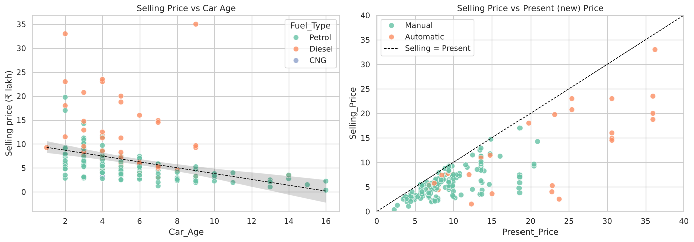
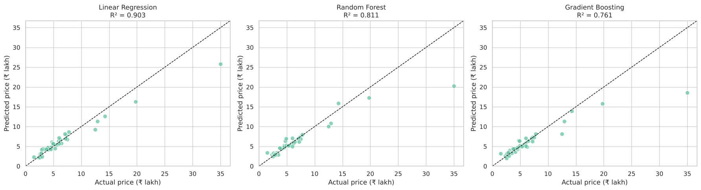
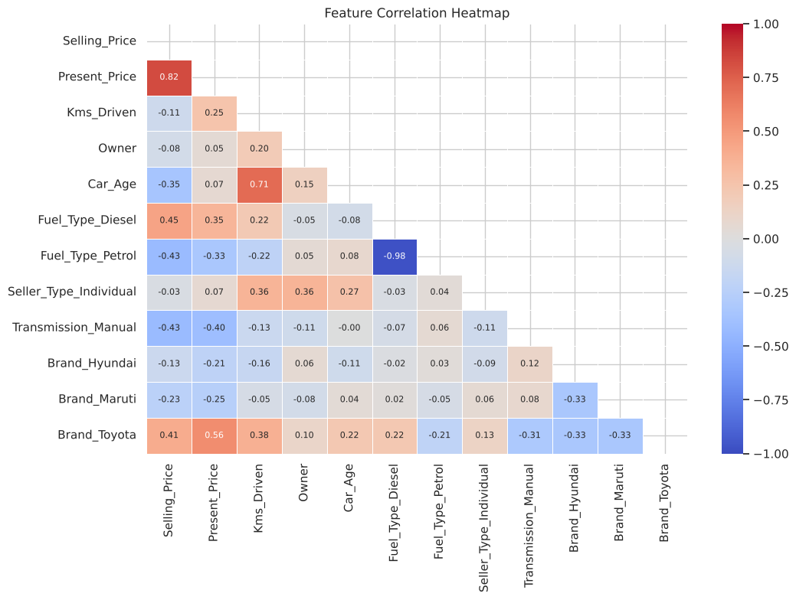
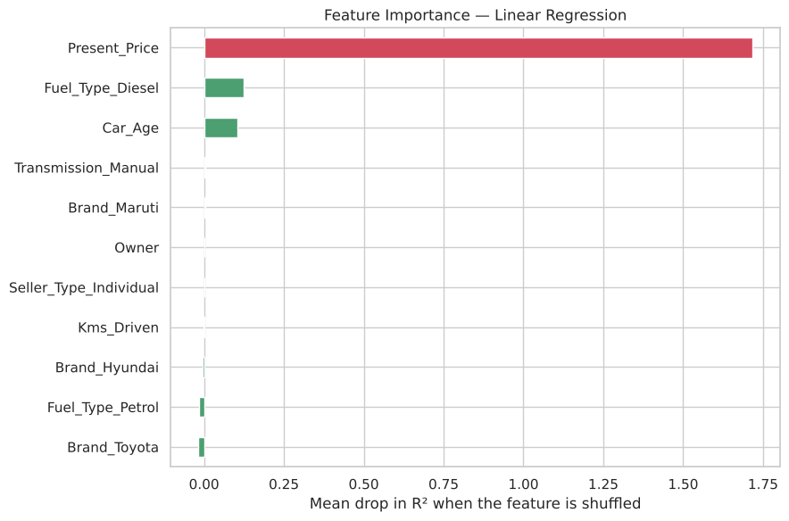

# 🚗 Car Price Prediction with Machine Learning

**Oasis Infobyte Internship (OIBSIP) · Data Science · Task 3**
**Author:** Anshu Raj

## Objective
Build a regression model that predicts the **selling price of a used car** from features such as brand, age, kilometres driven, fuel type and transmission.

## Tech Stack
Python · pandas · NumPy · scikit-learn · matplotlib · seaborn · Jupyter Notebook

## Dataset
[Vehicle dataset from CarDekho](https://www.kaggle.com/datasets/nehalbirla/vehicle-dataset-from-cardekho) (Kaggle), file `car data.csv`: 301 used-vehicle listings with `Car_Name, Year, Selling_Price, Present_Price, Kms_Driven, Fuel_Type, Seller_Type, Transmission, Owner`. Prices are in ₹ lakh.

## Project Structure
```
DataScience-Task3-CarPricePrediction/
├── Car_Price_Prediction.ipynb   # complete, executed notebook
├── data/car data.csv            # dataset
├── requirements.txt
├── README.md
└── outputs/                     # saved plots + HTML export of the notebook
```

## Workflow
1. **Data cleaning:** null check with a median/mode fallback, 2 duplicate rows removed, text standardised (extra spaces, mixed case, canonical categories such as `petrol → Petrol`, `cng → CNG`)
2. **Feature engineering:**
   - `Car_Age = 2019 − Year` (listings were collected around 2019)
   - `Brand` extracted from the vehicle name, using a model → brand map for cars (e.g. *swift → Maruti*, *city → Honda*)
   - 101 two-wheelers found in the file and excluded, leaving 198 cars
3. **EDA:** selling-price distribution (right-skewed), price vs fuel type / transmission / brand box plots, price vs car age and price vs present price scatter plots
4. **One-Hot Encoding** of `Fuel_Type`, `Seller_Type`, `Transmission`, `Brand` (`drop_first=True`)
5. **Correlation heatmap**
6. **80/20 train/test split** and **5-fold cross-validation**
7. **Models:** Linear Regression (log-log), Random Forest Regressor, Gradient Boosting Regressor
8. **Evaluation:** MAE, RMSE, R²
9. **Feature importance:** permutation importance for the best model, plus Gradient Boosting's built-in importance

## Results

| Model | MAE (₹ lakh) | RMSE (₹ lakh) | R² (test) | 5-fold CV R² |
|---|---|---|---|---|
| **Linear Regression (log-log)** 🏆 | **1.02** | **1.81** | **0.903** | **0.937 ± 0.021** |
| Gradient Boosting | 1.15 | 2.84 | 0.761 | 0.889 ± 0.062 |
| Random Forest | 1.06 | 2.53 | 0.811 | 0.863 ± 0.061 |

**Best model: Linear Regression on log-transformed price, present price and km driven.**
- Used cars lose a *percentage* of their value each year. On a log scale this becomes a straight line, which Linear Regression fits well even with only ~160 training cars.
- Tree models cannot predict prices above the range they were trained on. The test set includes a Land Cruiser (new price ₹92.6 lakh), which the trees badly under-predicted.
- The coefficients are easy to interpret: **+1% new-car price → +0.75% selling price**, **each extra year of age → about −7.7%**, **each previous owner → about −16%**.
- **Most important features:** Present_Price, then Fuel type (Diesel) and Car_Age.

## Screenshots

| Price vs car age | Actual vs predicted |
|---|---|
|  |  |

| Correlation heatmap | Feature importance (best model) |
|---|---|
|  |  |

## How to Run
```bash
pip install -r requirements.txt
jupyter notebook Car_Price_Prediction.ipynb
```
Keep `car data.csv` inside the `data/` folder, then choose **Run All**.
