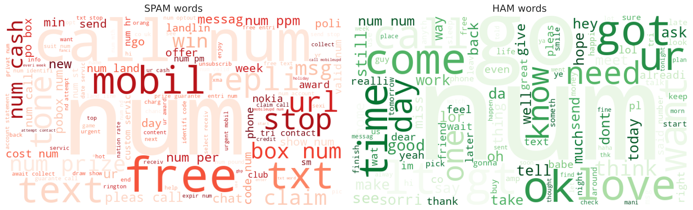
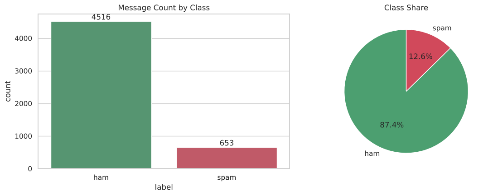
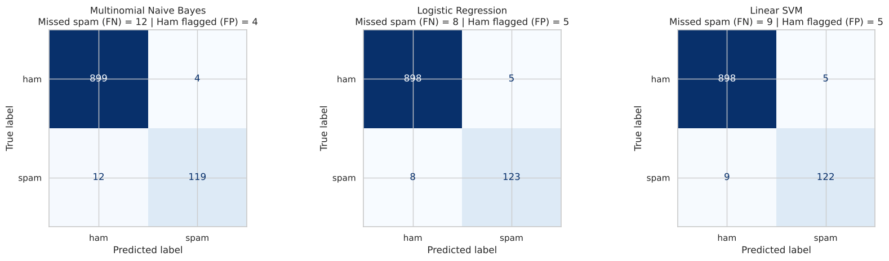

# 📧 Email Spam Detection with Machine Learning

**Oasis Infobyte Internship (OIBSIP) · Data Science · Task 4**
**Author:** Anshu Raj

## Objective
Build a Natural Language Processing (NLP) binary classifier that distinguishes **spam** messages from legitimate (**ham**) messages.

## Tech Stack
Python · pandas · scikit-learn (TF-IDF, Multinomial Naive Bayes, Logistic Regression, Linear SVM) · NLTK · re · matplotlib · seaborn · WordCloud · Jupyter Notebook

## Dataset
[SMS Spam Collection](https://www.kaggle.com/datasets/uciml/sms-spam-collection-dataset) (UCI ML Repository / Kaggle): 5,572 English messages labelled `ham` or `spam`. After removing 403 duplicates, 5,169 messages remain (**87.4% ham / 12.6% spam**).

## Project Structure
```
DataScience-Task4-EmailSpamDetection/
├── Email_Spam_Detection.ipynb   # complete, executed notebook
├── data/spam.csv                # dataset
├── requirements.txt
├── README.md
└── outputs/                     # saved plots + HTML export of the notebook
```

## Workflow
1. **Data loading and cleaning:** keep label and text columns, remove duplicate messages
2. **Class distribution:** spam vs ham counts and percentages, plus message-length analysis
3. **Text preprocessing:** lowercase → URLs/numbers replaced with `url`/`num` tokens → punctuation removal → NLTK stopword removal → Porter stemming
4. **Bonus:** WordClouds for spam and ham words
5. **80/20 stratified train/test split**
6. **TF-IDF vectorisation** (unigrams + bigrams, fitted on training data only). The notebook explains what TF-IDF measures.
7. **Models:** Multinomial Naive Bayes, Logistic Regression, Linear SVM
8. **Evaluation:** accuracy, precision, recall, F1-score and confusion matrix
9. **Discussion:** why recall matters for spam detection

## Results (spam = positive class)

| Model | Accuracy | Precision | Recall | F1 | Missed spam |
|---|---|---|---|---|---|
| Multinomial Naive Bayes | 98.45% | **96.75%** | 90.84% | 0.937 | 12 |
| **Logistic Regression** 🏆 | **98.74%** | 96.09% | **93.89%** | **0.950** | **8** |
| Linear SVM | 98.65% | 96.06% | 93.13% | 0.946 | 9 |

**Best model: Logistic Regression** (`class_weight="balanced"`). It has the highest spam recall and the highest F1, missing only 8 of 131 spam messages in the test set. Naive Bayes has the highest precision and remains a strong, fast baseline.

**Why recall matters:** every missed spam message (False Negative) can be a phishing or scam message that reaches the inbox. With imbalanced data (87% ham), a model can show high accuracy while still missing a lot of spam; recall exposes this.

## Screenshots

| WordClouds (spam vs ham) |
|---|
|  |

| Class distribution | Confusion matrices |
|---|---|
|  |  |

## How to Run
```bash
pip install -r requirements.txt
jupyter notebook Email_Spam_Detection.ipynb
```
Keep `spam.csv` inside the `data/` folder, then choose **Run All**. NLTK stopwords are downloaded automatically on the first run.
